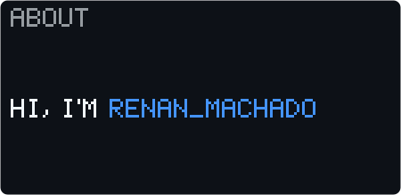
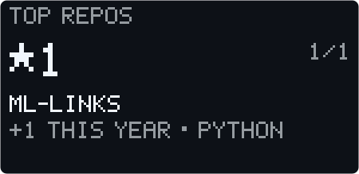

### Hi, I'm Renan 👋

Senior Software Engineer based in Brazil, working remotely with global teams. I build backend and cloud systems for banking and payments, mainly with **Java, Spring Boot, Kafka and AWS**. Recent work includes a messaging system handling 40,000+ requests per minute and an automatic-debit platform processing 100K+ debits per minute.

- 🔭 Currently: **Software Engineer on a parts pricing system for a global dealer network (contract, remote)**
- 🛠️ Core: **Java · Spring Boot · Kafka · RabbitMQ · AWS · Docker · Kubernetes · Terraform**
- 🚀 Side projects: **[Linkedify](https://linkedify.com.br)** (LinkedIn content SaaS) and **[Nigma AI](https://nigmaai.com)** (AI study platform)
- 🌐 Portfolio: **[renanmachad.me](https://renanmachad.me)**
- 📥 Reach me: [renanmachadopinho@gmail.com](mailto:renanmachadopinho@gmail.com) · [LinkedIn](https://www.linkedin.com/in/renan-machado-pinho-2509251a5/) · [GitHub](https://github.com/renanmachad)

### Highlights

- **Throughput:** built a Java, Kafka and RabbitMQ messaging system at Santander processing 40,000+ requests per minute.
- **Performance:** raised ECS application performance by 55% at Itaú by refining auto-scaling policies.
- **Cost:** cut AWS costs by 10% at Itaú with a DynamoDB table purging process.
- **Reliability:** added 100+ automated JUnit/Mockito tests across card services at Santander.

  
Stack

   
  

  
GitHub stats

   
  
  

<!-- cool-readme:start -->
<!-- Cards by github-cool-readme: https://github.com/pedrocatalao/github-cool-readme -->

<picture>
  <source media="(prefers-color-scheme: dark)" srcset="https://raw.githubusercontent.com/renanmachad/renanmachad/cards/summary-dark.svg">
  
</picture>
<picture>
  <source media="(prefers-color-scheme: dark)" srcset="https://raw.githubusercontent.com/renanmachad/renanmachad/cards/languages-dark.svg">
  
</picture>

<picture>
  <source media="(prefers-color-scheme: dark)" srcset="https://raw.githubusercontent.com/renanmachad/renanmachad/cards/contributions-dark.svg">
  
</picture>
<picture>
  <source media="(prefers-color-scheme: dark)" srcset="https://raw.githubusercontent.com/renanmachad/renanmachad/cards/weekly-dark.svg">
  
</picture>

<picture>
  <source media="(prefers-color-scheme: dark)" srcset="https://raw.githubusercontent.com/renanmachad/renanmachad/cards/streaks-dark.svg">
  
</picture>
<picture>
  <source media="(prefers-color-scheme: dark)" srcset="https://raw.githubusercontent.com/renanmachad/renanmachad/cards/about-dark.svg">
  
</picture>

<picture>
  <source media="(prefers-color-scheme: dark)" srcset="https://raw.githubusercontent.com/renanmachad/renanmachad/cards/repos-dark.svg">
  
</picture>

<!-- cool-readme:end -->
